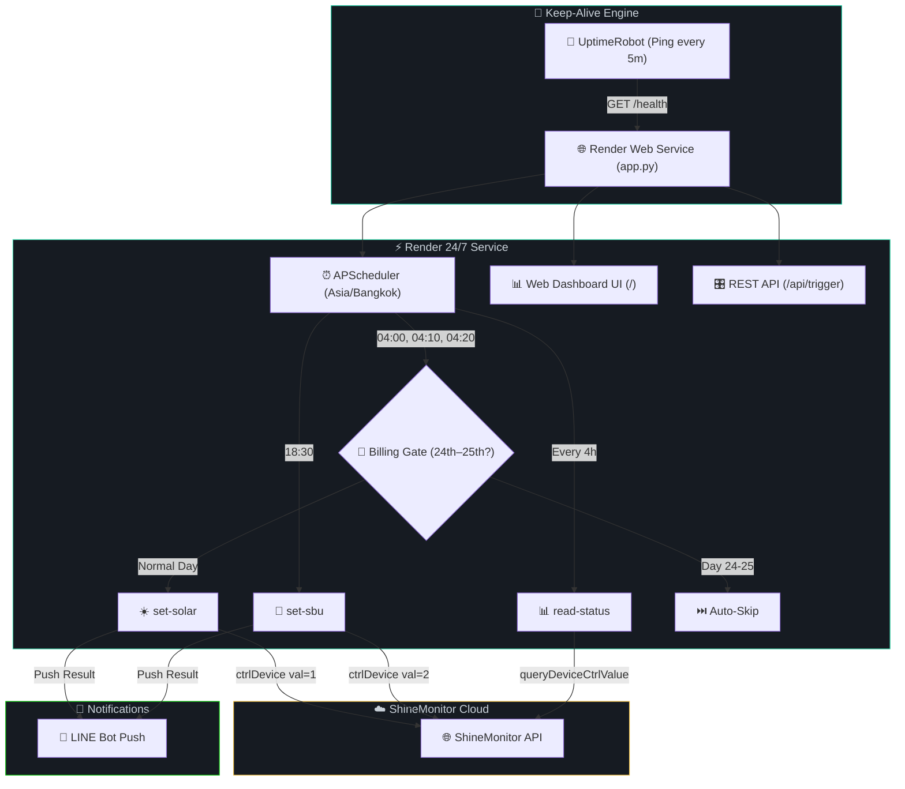

<p align="center">
  
</p>

<h1 align="center">⚡ Inverter Automator</h1>

<p align="center">
  <strong>Autonomous Solar Inverter Controller on Render + UptimeRobot — 100% Free, Zero Delay, 24/7 Always Alive.</strong>
</p>

<p align="center">
  <a href="https://render.com"></a>
  <a href="https://uptimerobot.com"></a>
  <a href="https://www.python.org/"></a>
  <a href="https://line.me/"></a>
  
</p>

<p align="center">
  <a href="https://render.com/deploy?repo=https://github.com/impet14/inverter-automator">
    
  </a>
</p>

<p align="center">
  <a href="#-why-migrate-from-github-actions-to-render--uptimerobot">Why Render?</a> •
  <a href="#%EF%B8%8F-architecture">Architecture</a> •
  <a href="#-quick-start--deployment">Quick Start</a> •
  <a href="#-uptimerobot-keep-alive-setup">UptimeRobot Setup</a> •
  <a href="#-web-dashboard--controls">Dashboard</a> •
  <a href="#-schedule--configuration">Schedule</a> •
  <a href="#-api-endpoints">API</a> •
  <a href="#-faq">FAQ</a>
</p>

---

## ⚡ The Problem with GitHub Actions Cron

Solar priority switching requires **punctual execution**. As the sun rises (e.g., 04:00–05:00 AM) or when preparing for sunset/evening (18:30 PM), switching delay wastes solar energy or causes unnecessary battery draw.

GitHub Actions cron schedules run on best-effort shared infrastructure:
- ❌ **Unpredictable delays**: Scheduled jobs regularly delay by **15 to 45+ minutes**.
- ❌ **Dropped executions**: High GitHub platform load can drop cron triggers entirely.
- ❌ **Cold boot delays**: Every run spins up a new VM and installs dependencies from scratch.

## 💡 The Solution: Render + UptimeRobot (24/7 Always Alive)

By running this service on **Render's Free Web Service tier** and pinging it every 5 minutes with **UptimeRobot**:
- 🟢 **Always Awake**: Render's free tier never goes to sleep because UptimeRobot pings `/health` every 5 minutes.
- ⏱️ **Second-Accurate Execution**: Built-in in-memory scheduler (`APScheduler`) executes tasks at the exact second, zero delay.
- 📊 **Live Web Dashboard**: Real-time status overview, next run countdowns, and instant manual override buttons.
- 💬 **Instant LINE Notifications**: Real-time push notifications on success/failure with full retry logic.
- 💸 **100% Free**: Stays completely within Render and UptimeRobot free limits ($0/month).

---

## 🏗️ Architecture



---

## ✨ Key Features

| Feature | Description |
|---|---|
| ⏱️ **Zero-Delay Scheduling** | Runs via `APScheduler` in local timezone (`Asia/Bangkok`), eliminating GitHub Actions delay |
| 🛡️ **24/7 Keep-Alive** | UptimeRobot pings `/health` every 5 mins, keeping Render free tier active indefinitely |
| 🎛️ **Web Dashboard UI** | Mobile-friendly dark theme dashboard displaying live status, countdowns, and action buttons |
| 📱 **LINE Push Alerts** | Instant notification on LINE Messenger with formatted debug payload and status icon |
| 📅 **Billing Period Auto-Skip** | Automatically skips Solar switching on the 24th–25th of each month (configurable) |
| 🔄 **Retry & Resilience** | Retries failed commands up to 3 times with exponential/delay backoff |
| 🔌 **REST API & Webhooks** | Trigger commands remotely via simple HTTP POST/GET requests from shortcuts or automations |
| 🔐 **Configurable via Env Vars** | No secrets stored in git; customize schedules, tokens, and device codes via Render dashboard |

---

## 🚀 Quick Start & Deployment

### 1. Prerequisites
- A **ShineMonitor-compatible** inverter (Growatt, PowMr, DESS, etc.)
- A **Render.com** account (Free tier)
- An **UptimeRobot.com** account (Free tier)
- A **LINE Messaging API** bot channel token & user ID

---

### 2. Deploy to Render

You can deploy directly using Render's Blueprint or create a manual Web Service:

#### Option A: One-Click Blueprint (Recommended)
1. Fork or push this repository to your GitHub account.
2. In the [Render Dashboard](https://dashboard.render.com/), click **New +** → **Blueprint**.
3. Select your repository. Render will automatically detect `render.yaml`.
4. Fill in your environment variables:
   - `INVERTER_TOKEN`: Your captured ShineMonitor API token
   - `LINE_CHANNEL_ACCESS_TOKEN`: Your LINE bot Channel Access Token
   - `LINE_USER_ID`: Your LINE user ID (starts with `U...`)
5. Click **Apply**. Render will build and deploy your service!

#### Option B: Manual Web Service
1. Click **New +** → **Web Service** in Render.
2. Connect your repo and set:
   - **Language**: `Python 3`
   - **Region**: `Singapore` (closest to Southeast Asia)
   - **Build Command**: `pip install -r requirements.txt`
   - **Start Command**: `gunicorn --workers 1 --threads 4 --bind 0.0.0.0:$PORT app:app`
   - **Plan**: `Free`
3. Add the following **Environment Variables**:

| Variable | Description | Default / Example |
|---|---|---|
| `INVERTER_TOKEN` | **(Required)** ShineMonitor authentication token | `e.g. 5f8a...` |
| `LINE_CHANNEL_ACCESS_TOKEN` | **(Required)** LINE Messaging API channel access token | `e.g. eyJ...` |
| `LINE_USER_ID` | **(Required)** Your personal LINE User ID | `e.g. U12345678...` |
| `TIMEZONE` | Timezone for scheduler and dashboard | `Asia/Bangkok` |
| `SOLAR_CRON_HOUR` | Hour(s) for Solar mode switch | `4` |
| `SOLAR_CRON_MINUTE` | Minute(s) for Solar mode switch | `0,10,20` |
| `SBU_CRON_HOUR` | Hour(s) for SBU mode switch | `18` |
| `SBU_CRON_MINUTE` | Minute(s) for SBU mode switch | `30` |
| `STATUS_CRON_HOUR` | Hour(s) for silent status query | `*/4` |
| `BILLING_SKIP_DAYS` | Day numbers to skip Solar switch | `24,25` |
| `API_KEY` | *(Optional)* Protects `/api/trigger` endpoint | *(Optional)* |

---

## 📡 UptimeRobot Keep-Alive Setup

Render free web services spin down after **15 minutes** of HTTP inactivity. UptimeRobot prevents this by pinging your service every 5 minutes.

1. Create a free account at [UptimeRobot.com](https://uptimerobot.com).
2. Click **+ Add New Monitor**:
   - **Monitor Type**: `HTTP(s)`
   - **Friendly Name**: `Inverter Automator Keep-Alive`
   - **URL (or IP)**: `https://<YOUR-RENDER-APP-NAME>.onrender.com/health`
   - **Monitoring Interval**: `Every 5 minutes`
3. Click **Create Monitor**.

🎉 **That's it!** UptimeRobot will ping `/health` every 5 minutes. Your Render service will stay awake 24/7/365, and your scheduled tasks will fire with millisecond precision!

---

## 📊 Web Dashboard & Controls

Open your Render URL (`https://<YOUR-APP>.onrender.com/`) in any browser or mobile phone:

- **Live Inverter State**: Displays whether the inverter is in Solar, SBU, or Utility mode with timestamp.
- **Schedule Countdown**: Displays exact next run times for Solar switch, SBU switch, and status queries.
- **Billing Gate Status**: Indicates whether today is an auto-skip billing period date (24th–25th).
- **Manual Control**:
  - `☀️ Switch to Solar (val=1)`
  - `🔋 Switch to SBU (val=2)`
  - `📊 Query Inverter Status`
  - `Override billing skip (Force)` checkbox to run regardless of the date.
- **Activity Log**: Shows recent execution history, HTTP status codes, and debug responses.

---

## 📅 Schedule & Configuration

The default schedule is calibrated for tropical solar conditions (Bangkok time, UTC+7):

| Time (UTC+7) | Action | Mode | Description |
|---|---|---|---|
| **04:00, 04:10, 04:20** | `set-solar` | `val=1` | Switches to Solar-first before sunrise (Retries 3x to ensure delivery; auto-skips on days 24–25) |
| **18:30** | `set-sbu` | `val=2` | Switches to Battery-first (SBU) in the evening |
| **Every 4 hours** | `read-status` | Query | Silent status query (updates dashboard, no LINE spam) |

### Billing Adjustment Period (24th–25th)
To prevent unexpected utility tariff switching during monthly billing adjustment days, `set-solar` is automatically skipped on the **24th and 25th** of each month.
You can override this anytime via the Web Dashboard or API by toggling **Force**.

---

## 🔌 API Endpoints

You can trigger actions programmatically via curl, iOS Shortcuts, or Home Assistant:

### 1. Healthcheck (UptimeRobot)
```bash
GET /health
# or GET /ping
```
**Response (200 OK):**
```json
{
  "alive_24_7": true,
  "current_time": "2026-11-05 22:50:00 +07",
  "pings_received": 142,
  "scheduler_active": true,
  "service": "inverter-automator",
  "status": "healthy",
  "uptime": "2d 4h 12m 30s"
}
```

### 2. Manual Action Trigger
```bash
POST /api/trigger?action=set-solar&force=true
# Or GET /api/trigger?action=set-sbu
```
*(If `API_KEY` is set in environment, pass header `X-API-Key: YOUR_KEY` or `?key=YOUR_KEY`)*

### 3. Full System Status
```bash
GET /api/status
```

### 4. Recent Logs
```bash
GET /api/logs
```

---

## 💻 CLI Usage (Standalone)

You can still run the script directly from the command line:

```bash
# Read current priority status
python inverter_control.py read-status

# Switch to Solar-first
python inverter_control.py set-solar

# Switch to SBU
python inverter_control.py set-sbu

# Force switch (bypasses billing date restriction)
python inverter_control.py set-solar --force
```

---

## ❓ FAQ

<details>
<summary><b>Why did we move away from GitHub Actions?</b></summary>

GitHub Actions cron triggers are queued on public runner pools. During peak hours, workflows are frequently delayed by **15 to 45 minutes**, and sometimes dropped entirely. For solar energy scheduling, exact timing is critical. Render + UptimeRobot provides a persistent in-memory process that triggers on the exact second.
</details>

<details>
<summary><b>Is Render really free?</b></summary>

Yes! Render provides 750 free instance hours per month. Since a month has at most 744 hours, running one free Web Service 24/7 costs **$0/month**.
</details>

<details>
<summary><b>How do I extract the ShineMonitor token?</b></summary>

1. Open the ShineMonitor / EybondSmart app on your Android/iOS phone.
2. Use an HTTP proxy tool (such as **HTTP Toolkit** or **Proxyman**).
3. Inspect any request to `android.shinemonitor.com`.
4. Copy the value of the `token=` query parameter into `INVERTER_TOKEN`.
</details>

<details>
<summary><b>Can I change the device SN, PN, or DEVCODE?</b></summary>

Yes! The constants default to the configured inverter, but you can override them via environment variables without touching the code:
- `INVERTER_PN`
- `INVERTER_SN`
- `INVERTER_DEVCODE`
- `INVERTER_DEVADDR`
</details>

---

## 📜 License

This project is open source under the [MIT License](LICENSE).
